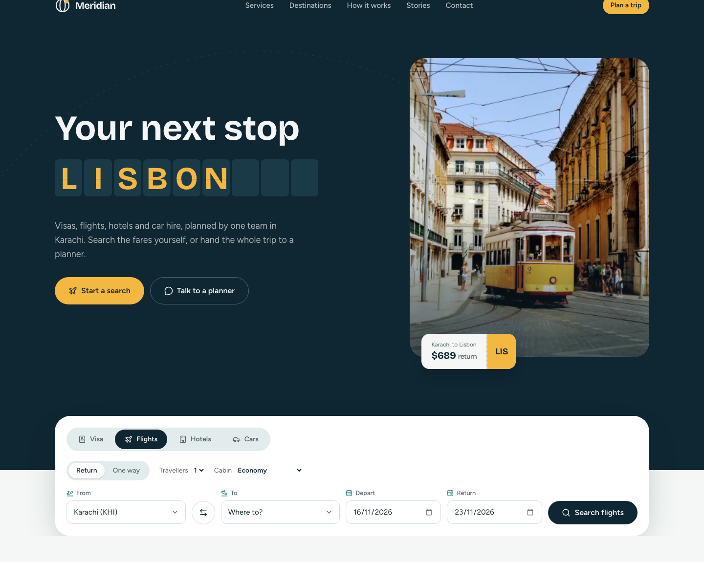

# Meridian Travel

A premium, fully responsive travel agency website built for the Frontend Developer (Next.js) technical assessment. Meridian
offers four services: **visa services, flight tickets, hotel booking and car rental**, each with a working search form
backed by mock data.

- **Live site:** https://meridian-travel-rose.vercel.app
- **Repository:** https://github.com/HarisJavedskipq2022/meridian-travel



## Tech stack

| Area      | Choice                                                                             |
| --------- | ---------------------------------------------------------------------------------- |
| Framework | Next.js 16 (App Router, Turbopack, Cache Components), React 19, TypeScript         |
| Styling   | Tailwind CSS v4 (design tokens in `@theme`), `clsx` + `tailwind-merge`             |
| Animation | GSAP 3 with `@gsap/react` (`useGSAP`), ScrollTrigger, SplitText, Flip              |
| Icons     | lucide-react                                                                       |
| Fonts     | Bricolage Grotesque (display) and Figtree (body) via `next/font`                   |
| Quality   | ESLint (`eslint-config-next`), Prettier + `prettier-plugin-tailwindcss`, strict TS |

No backend or external API is used. All results are generated from local mock data.

## Getting started

Requires Node.js 20.9 or newer.

```bash
npm install
npm run dev
```

Open http://localhost:3000.

### Scripts

| Script              | What it does                                  |
| ------------------- | --------------------------------------------- |
| `npm run dev`       | Start the dev server                          |
| `npm run build`     | Production build                              |
| `npm start`         | Serve the production build                    |
| `npm run typecheck` | `tsc --noEmit`                                |
| `npm run lint`      | ESLint                                        |
| `npm run format`    | Format everything with Prettier               |
| `npm run check`     | Typecheck, lint and formatting check together |

## Features

### Pages

- **`/`** Home: hero with search, stats, services, popular destinations, how it works, testimonials, contact form and footer.
- **`/search?type=…`** Results for any of the four services. The URL is the source of truth, so every search is shareable
  and the back button works.
- **404** Custom not-found page.

### Functional search (mock data)

| Service | Form fields                                                   | Results page                                                                         |
| ------- | ------------------------------------------------------------- | ------------------------------------------------------------------------------------ |
| Flights | Return / one way, from, to, dates, travellers, cabin          | Filter by stops, airline, max price. Sort by cheapest, fastest, earliest.            |
| Hotels  | Destination, check-in / check-out, guests, rooms              | Filter by stars, free cancellation, nightly budget. Sort by price, rating, distance. |
| Cars    | Pick-up airport, dates, driver age (young-driver fee applied) | Filter by car type and transmission. Sort by price or seats.                         |
| Visa    | Passport, destination, purpose                                | Visa type, stay allowed, processing time, fees and a document checklist.             |

- Validation is shared between the forms and the results page (`lib/search/validate.ts`), with inline, screen-reader
  friendly errors and focus moved to the first invalid field.
- Mock results are **deterministic**: a seeded PRNG keyed on the query means the same search always returns the same
  flights, hotels and cars. Flight durations and fares are derived from real great-circle distances between airports.
- Selecting any result opens a booking review dialog that "holds" the price and issues a reference number.
- Links such as `/search?type=hotels&city=LIS` work: missing dates default to two weeks out.

### GSAP animations

| Requirement    | Where                                                                                                                 |
| -------------- | --------------------------------------------------------------------------------------------------------------------- |
| Hero animation | One orchestrated load timeline: SplitText headline, departure-board tiles, photo unmask, search panel.                |
|                | The split-flap board then cycles destinations, with the photo and fare stub crossfading in sync.                      |
| Scroll reveals | `Reveal` batches `[data-reveal]` elements with `ScrollTrigger.batch`. The how-it-works route line scrubs with scroll. |
| Counters       | `Counter` counts up on first view; server HTML already contains the final number.                                     |
| Hover effects  | Magnetic hero CTA (`quickTo`), service card image drift and arrow pop, destination card zoom + note reveal.           |
| Interaction    | Sliding search tab indicator, Flip-animated destination filter, staggered result lists, dialog entrance.              |

Every animation is created inside `useGSAP` (automatic cleanup) and respects `prefers-reduced-motion` through
`gsap.matchMedia()` or an explicit check. Content hidden for reveals is only hidden when JavaScript is running.

## Project structure

```
src/
├─ app/                    # Routes, root layout, global styles, icon, 404
│  └─ search/page.tsx      # Suspense boundary around the client results view
├─ components/
│  ├─ layout/              # Navbar, Footer, Logo, newsletter form
│  ├─ sections/            # Home page sections (Hero, Services, Destinations, …)
│  ├─ search/              # SearchPanel tabs, the four forms, shared useSearchForm hook
│  ├─ results/             # Results per service, filters, booking dialog, skeleton
│  └─ ui/                  # Reusable primitives: Button, Field, Dialog, Reveal, Counter, SplitFlap, Magnetic, Stars
├─ data/                   # Mock content: airports, destinations, visa rules, services, testimonials
└─ lib/
   ├─ search/              # Pure, framework-free search logic
   │  ├─ types.ts          # Query types per service
   │  ├─ params.ts         # URL ⇄ typed query
   │  ├─ defaults.ts       # Date defaults
   │  ├─ validate.ts       # Shared validation
   │  └─ flights|hotels|cars|visa.ts  # Mock engines + filter/sort helpers
   ├─ gsap.ts              # Single place that registers GSAP plugins
   └─ dates.ts, format.ts, random.ts, validation.ts, cn.ts, images.ts
```

### Design decisions

- **Separation of concerns.** Search logic in `lib/search` is pure TypeScript with no React, so it is easy to test or
  swap for a real API later. Components only hold UI state.
- **Server components by default.** Static sections (Stats, Services, Contact, Footer) are server components. Client
  components are limited to what needs state or animation.
- **Prerender-safe dates.** `useToday()` uses `useSyncExternalStore` so prerendered HTML never contains a build-time
  date, which matters with Cache Components enabled.
- **Accessible by default.** Skip link, labelled fields with `aria-invalid`/`aria-describedby`, keyboard-operable tabs
  (arrow keys), native `<dialog>` for focus trapping, visible focus rings, `aria-pressed` filter chips.
- **Design tokens.** Colours, fonts and radii live in `@theme` in `globals.css` and are used as Tailwind utilities
  (`bg-ink`, `text-saffron`, `font-display`).

## Deploying to Vercel

1. Push this repository to GitHub.
2. In Vercel, choose **Add New → Project**, import the repository and keep the detected Next.js settings.
3. Deploy. No environment variables are needed.

Or from the CLI: `npx vercel` and follow the prompts.

## Notes and limitations

- Prices, visa rules, airlines, hotels and reviews are illustrative mock data, not real offers or legal guidance.
- Photos are loaded from Unsplash through `next/image`, so the site needs internet access to show images.
- Contact, newsletter and booking forms simulate submission locally; nothing is sent anywhere.

## Credits

Photography from [Unsplash](https://unsplash.com). Icons by [Lucide](https://lucide.dev).
